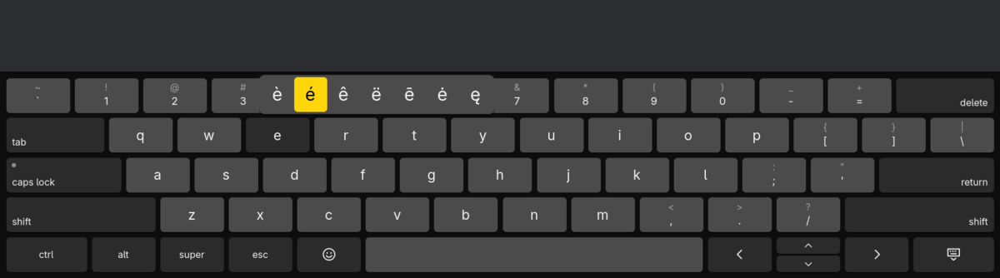
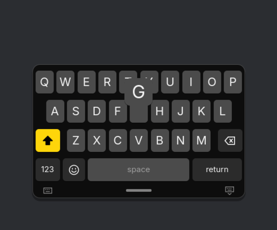

# floatkey

An on-screen keyboard for Omarchy on a tablet that behaves like the iPad's.
Docked along the bottom it is a full 13"-iPad keyboard, with a number row,
tab, caps lock, ctrl, alt, super, esc and arrows. Pinch it, and it shrinks to a
small iPhone-size keyboard that you drag anywhere on the screen or tuck into the
bottom left or right corner, for typing with one finger.





## Placements

| Placement | How to get there |
|---|---|
| Docked | Spread two fingers on the floating keyboard, drag it down past the bottom edge, or pick it from the menu. Windows move up to make room. |
| Floating | Pinch two fingers on the docked keyboard, or pick it from the menu. Drag the grabber under it to move it anywhere. |
| Left or right corner | Drag the floating keyboard into a bottom corner, or pick it from the menu. |

The menu opens from a long press on the docked keyboard's hide key (slide onto
a placement and lift), or from the keyboard button on the floating keyboard's
grabber strip. floatkey remembers the placement and where you left it floating.

## Typing

| Gesture | What it does |
|---|---|
| Tap shift | Capitalises the next letter. Double-tap to lock; caps lock does the same on the full keyboard. |
| Hold a letter | Its accents (é è ê ë…), slide to one and lift. Also `$` → € £ ¥, `-` → – —, `"` → „ “ ” « ». |
| Flick down on a key | Types the character shown above it on the full keyboard (`1` → `!`). |
| Hold or slide the space bar | Turns the keyboard into a trackpad that moves the text cursor; with shift on it selects. |
| Two quick spaces | Full stop and space. |
| Tap ctrl, alt or super | Applies to the next key (ctrl, then c is Ctrl+C); double-tap to lock. super then space opens the Omarchy menu. |
| Hold delete or an arrow | Repeats, faster after a while. |
| 123, #+= | Numbers and symbols on the small keyboard; press 123 and slide to a key to type one and come straight back. |
| 😀 / 🌐 | Emoji, or the next layout when there is more than one. |

Fingers can overlap: keys are typed in the order they went down, and the key
under the finger when it lifts is the one that counts.

## Commands

```bash
floatkey                 # start it, shown
floatkey --hidden        # start it hidden, for a session autostart
floatkey toggle          # show or hide (starts it if needed); also show, hide
floatkey dock            # also float, left, right
floatkey status          # shown docked de
floatkey type "Grüße 👋"  # type into the focused window
floatkey key ctrl+c      # press a key: BackSpace, Return, super+space, shift+Left...
floatkey quit
```

## Settings

`~/.config/floatkey/floatkey.conf`, read at start:

```ini
layouts=de, us          ; the globe key cycles through these (us and de so far)
dockedScale=1.0         ; 0.6–1.6, height of the docked keyboard
compactScale=1.0        ; 0.6–1.8, size of the floating keyboard
autoCapitalize=false    ; capitalise after . ! ? and return
doubleSpacePeriod=true
```

Without `layouts`, floatkey uses Hyprland's `input:kb_layout`. Colors follow
the Omarchy theme live.

## Install

```bash
bin/install
```

builds the package and installs it with `makepkg -si`. On the OnePlus Pad
tablet setup (`pad4-tablet`), `iceland-osk` and the swipe up from the bottom
edge use floatkey when it is installed.

For Hyprland, keep the compositor from animating the overlay (floatkey animates
itself):

```lua
hl.layer_rule({ match = { namespace = "^floatkey$" }, no_anim = true, animation = "none" })
```

## How it works

floatkey draws on one transparent layer-shell overlay that covers the screen,
and tells Hyprland that only the keyboard's rectangle takes touches. That lets
the keyboard follow the finger and change shape smoothly. It never takes
keyboard focus. Docked, it reserves the bottom of the screen so windows move
up.

Keys reach the focused app through the Wayland virtual keyboard protocol, with
a keymap based on your own layout. That keeps shortcuts and Hyprland bindings
on the keys they expect. Every other character (umlauts, accents, emoji) goes
on a keycode your keymap leaves empty, so no binding can ever fire by mistake.
A character not yet in the keymap brings a fresh virtual keyboard with a new
keymap, because Hyprland and input methods such as fcitx5 only pick up a
keymap when a keyboard first becomes active.

Limits: X11 apps under Xwayland only receive the first 26 such characters (the
umlauts, ß and € among them); Wayland apps receive all of them. floatkey
doesn't yet pop up by itself when a text field gets focus, because that
needs the input-method protocol, which fcitx5 holds.

## Development

```bash
bin/build     # build/floatkey
bin/test      # unit tests, and touch gestures on the real QML, offscreen
```
