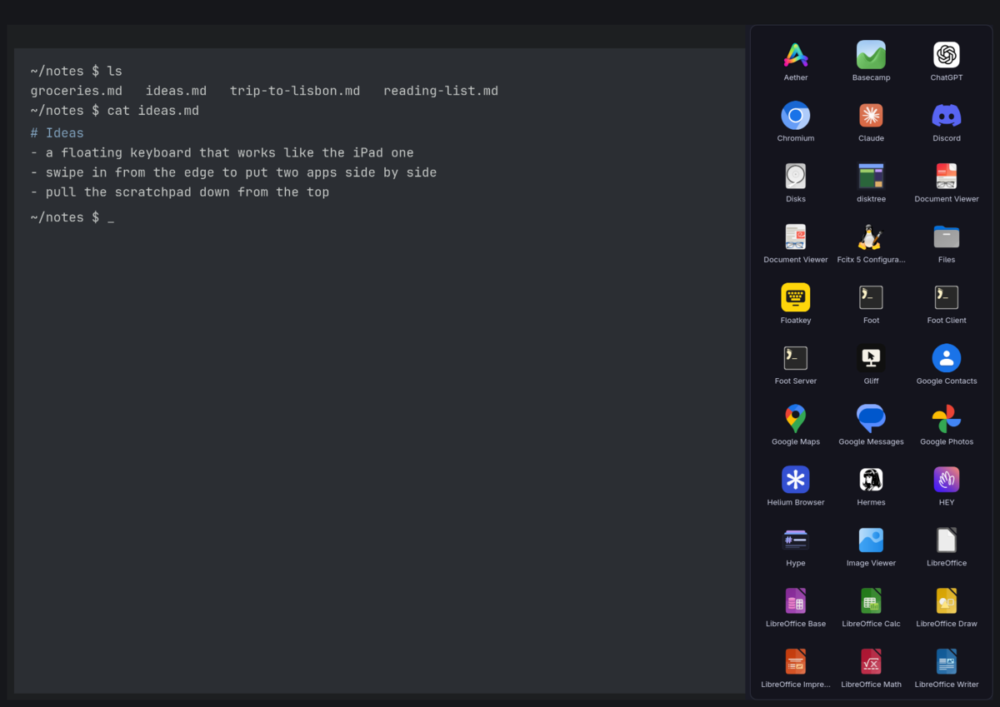
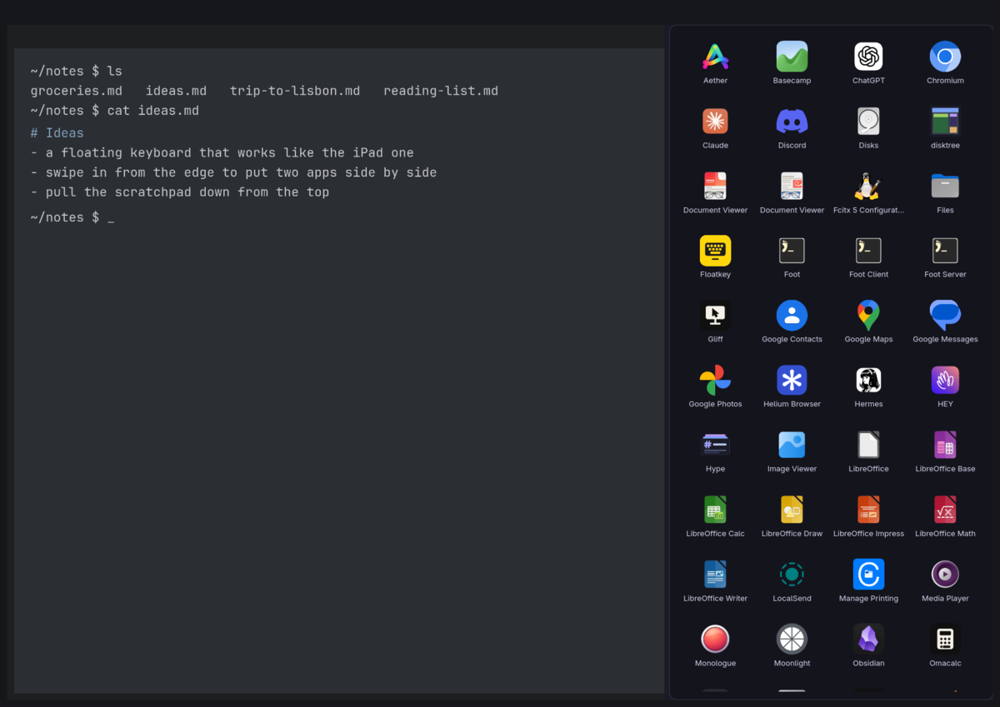

# stage

iPad-style multitasking for Omarchy on a tablet. Drag in from the right edge
and the window under your finger gets smaller: the room it gives up becomes the
launcher, and the app you tap opens there. Drag up from the bottom edge to do
the same the other way. Pull the scratchpad console down from the top.





## Gestures

| Gesture | What it does |
|---|---|
| One finger in from the **right edge** | Shrinks the window beside your finger sideways; the launcher fills the room |
| One finger up from the **bottom edge** | Shrinks the window above your finger upward; the launcher fills the room |
| One finger down from the **top edge** | Pulls Omarchy's scratchpad console down; an empty one offers the launcher |
| Tap or push up on the dimmed screen | Sends the console back up |
| Three fingers sideways | Next or previous workspace (lisgd, from the tablet session) |

While you drag, a picture of the window follows your finger; when you let go
it lands on a third, a half or two thirds, whichever is nearest. A short, quick
flick makes halves; a short or slow pull springs back. Tap an app and its window
opens where the launcher was; tap beside the launcher to put things back.

A workspace holds at most four windows (two each way), the console two. Past
that, or splitting a window that already shares its width or height, the
picture only gives a little and springs back, so you can feel there's no more
room. While a docked keyboard owns the bottom edge, only the right and top work.

On an empty workspace the right or bottom edge opens the launcher on the whole screen.


## Commands

```bash
stage                          # run (the tablet session starts it)
stage status                   # console=closed apps=55
stage launch foot right 0.66   # what the launcher does: foot beside the focused window
stage launch firefox console   # ...or in the console
stage console open             # bring the console down; also close
stage quit
```

## How it works

stage is one transparent layer-shell overlay over the whole screen that only
takes touches in strips along the edges, so a finger landing there reaches
stage instead of the app underneath. When it does, stage captures the screen
(ext-image-copy-capture) and moves that picture under the finger; the real
windows don't relayout on every frame, which is what keeps it smooth.

Letting go on an app tells Hyprland, over its socket, to focus the window that
made room, put the next window beside or under it (dwindle's preselect),
launch the app through `uwsm-app` the way Omarchy does, and once its window is
up, set the split to where your finger left it. The console comes down without
Hyprland sliding it a second time: its `specialWorkspaceIn` animation is
switched off for that one toggle and put back exactly as it was.

## Install

```bash
bin/install
```

On the OnePlus Pad tablet setup (`pad4-tablet`), the tablet session starts
stage when it's installed and leaves lisgd only the three-finger swipes.
Keep Hyprland from animating the overlay:

```lua
hl.layer_rule({ match = { namespace = "^stage$" }, no_anim = true, animation = "none" })
```

## Development

```bash
bin/build     # build/stage
bin/test      # unit tests, and the gestures on the real QML, offscreen
QT_LOGGING_RULES="stage.debug=true" build/stage   # what each gesture sees
```
