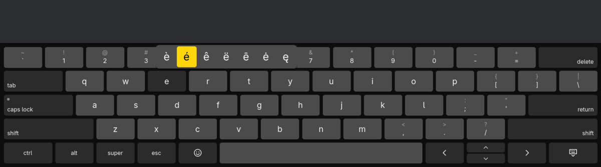
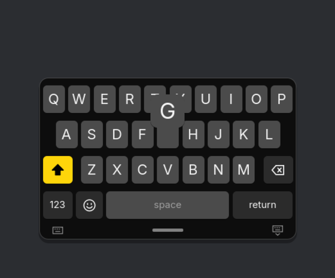

# floatkey

An on-screen keyboard for Omarchy on a tablet that behaves like the iPad's.
Docked along the bottom it is a full 13"-iPad keyboard, with a number row,
tab, caps lock, ctrl, alt, super, esc and arrows. Pinch it, and it shrinks to a
small iPhone-size keyboard that you drag anywhere on the screen or tuck into the
bottom left or right corner, for typing with one finger.





## Showing up by itself

Like an iPad's, the keyboard comes up when you tap into a text field and goes
away when the field loses focus. Apps already tell fcitx5, Omarchy's input method,
when a field takes focus: GTK and Electron apps over Wayland, Qt apps over
D-Bus. floatkey ships a small fcitx5 addon that passes this on.

- Moving from one field to the next keeps the keyboard up; it only goes once no
  field has focus for a quarter of a second.
- Hide it in a field and it stays hidden until the next field takes focus.
  Swipe up from the bottom edge to bring it back sooner.
- Open it yourself with no field focused, and it stays until you hide it.
- Terminals always count as a text field, so the keyboard comes up whenever one
  has focus. `autoShowInTerminals=false` turns that off.
- While a hardware keyboard is connected (built in, USB or Bluetooth), fields
  don't bring it up; connecting one hides a keyboard that came up by itself.
  Swiping up still shows it. `autoShowWithKeyboard=true` turns that off.

fcitx5 loads the addon when it starts, so after installing restart it once:

```bash
systemctl --user restart omarchy-fcitx5.service
```

## Placements

| Placement | How to get there |
|---|---|
| Docked | Spread two fingers on the floating keyboard, drag it down past the bottom edge, or pick it from the menu. Windows move up to make room. |
| Floating | Pinch two fingers on the docked keyboard, or pick it from the menu. Drag the grabber under it to move it anywhere. |
| Left or right corner | Drag the floating keyboard into a bottom corner, or pick it from the menu. |

The menu opens from a long press on the docked keyboard's hide key (slide onto
a placement and lift), or from the keyboard button on the floating keyboard's
grabber strip. floatkey remembers the placement and where you left it floating.

## Typing

| Gesture | What it does |
|---|---|
| Tap shift | Capitalises the next letter. Double-tap to lock; caps lock does the same on the full keyboard. |
| Hold a letter | Its accents (é è ê ë…), slide to one and lift. Also `$` → € £ ¥, `-` → – —, `"` → „ “ ” « ». |
| Flick down on a key | Types the character shown above it on the full keyboard (`1` → `!`). |
| Hold or slide the space bar | Turns the keyboard into a trackpad that moves the text cursor; with shift on it selects. |
| Two quick spaces | Full stop and space. |
| Tap ctrl, alt or super | Applies to the next key (ctrl, then c is Ctrl+C); double-tap to lock. super then space opens the Omarchy menu. |
| Hold delete or an arrow | Repeats, faster after a while. |
| 123, #+= | Numbers and symbols on the small keyboard; press 123 and slide to a key to type one and come straight back. |
| 😀 / 🌐 | Emoji, or the next layout when there is more than one. |

Fingers can overlap: keys are typed in the order they went down, and the key
under the finger when it lifts is the one that counts.

## Voice typing

With [Superwhisper](https://superwhisper.com) installed, the floating keyboard
has a voice orb in the middle of its grabber strip, and the docked one a mic
key beside the emoji key. Tap it and speak, tap again and Superwhisper types
what you said into the focused field; or hold it while you talk and let go.
While it listens the orb lights up in the theme's accent and glows with your
voice, a × beside it (or esc) lets the words go, and the keyboard itself
glows. It breathes while the words are worked out and shows a tick as they go
in. A dictation started with Omarchy's dictation key shows on the orb too.

## Commands

```bash
floatkey                 # start it, shown
floatkey --hidden        # start it hidden, for a session autostart
floatkey toggle          # show or hide (starts it if needed); also show, hide
floatkey dock            # also float, left, right
floatkey status          # shown docked de
floatkey type "Grüße 👋"  # type into the focused window
floatkey key ctrl+c      # press a key: BackSpace, Return, super+space, shift+Left...
floatkey focus url       # a field took focus (the fcitx5 addon sends these); also blur
floatkey quit
```

## Settings

`~/.config/floatkey/floatkey.conf`, read at start:

```ini
layouts=de, fr, us(dvorak) ; the globe key cycles through these; any XKB layout
dockedScale=1.0         ; 0.6–1.6, height of the docked keyboard
compactScale=1.0        ; 0.6–1.8, size of the floating keyboard
autoCapitalize=false    ; capitalise after . ! ? and return
doubleSpacePeriod=true
autoShow=true           ; come up when a text field takes focus
autoShowInTerminals=true
autoShowWithKeyboard=false ; also come up while a hardware keyboard is connected
```

Without `layouts`, floatkey uses Hyprland's `input:kb_layout` and
`input:kb_variant`. The keys show what XKB says each layout types, so any
layout looks the way the hardware keyboard has it; the small keyboard's
number and symbol pages and the long-press accents are floatkey's own (German
and US, the US ones for the rest). `floatkey layouts` prints the layouts and
their keys as JSON. Colors follow the Omarchy theme live.

## Install

```bash
bin/install
```

builds the package and installs it with `makepkg -si`. On the OnePlus Pad
tablet setup (`pad4-tablet`), `iceland-osk` and the swipe up from the bottom
edge use floatkey when it is installed.

For Hyprland, keep the compositor from animating the overlay (floatkey animates
itself):

```lua
hl.layer_rule({ match = { namespace = "^floatkey$" }, no_anim = true, animation = "none" })
```

## How it works

floatkey draws on one transparent layer-shell overlay that covers the screen,
and tells Hyprland that only the keyboard's rectangle takes touches. That lets
the keyboard follow the finger and change shape smoothly. It never takes
keyboard focus. Docked, it reserves the bottom of the screen so windows move
up.

Keys reach the focused app through the Wayland virtual keyboard protocol, with
a keymap based on your own layout. That keeps shortcuts and Hyprland bindings
on the keys they expect. Every other character (umlauts, accents, emoji) goes
on a keycode your keymap leaves empty, so no binding can ever fire by mistake.
A character not yet in the keymap brings a fresh virtual keyboard with a new
keymap, because Hyprland and input methods such as fcitx5 only pick up a
keymap when a keyboard first becomes active.

Voice typing runs the `superwhisper` command (`start`, `stop`, `cancel`), the
same one Omarchy's dictation key uses, and follows the dictation on
Superwhisper's control socket. Superwhisper types the text through its own
fcitx5 addon. Superwhisper keeps its microphone levels to itself, so while it
listens floatkey opens the default microphone too, only to measure how loud
the voice is.

The fcitx5 addon (`fcitx5/`) watches fcitx5's focus events. Once each burst of
focus changes settles, it sends floatkey one line over its socket: `focus
url`, `focus text` or `blur`. The type comes from the field's hints (password,
terminal, url, email, number), for keyboards that fit the field later.

Limit: X11 apps under Xwayland only receive the first 26 such characters (the
umlauts, ß and € among them); Wayland apps receive all of them.

## Development

```bash
bin/build     # build/floatkey
bin/test      # unit tests, and touch gestures on the real QML, offscreen
```
