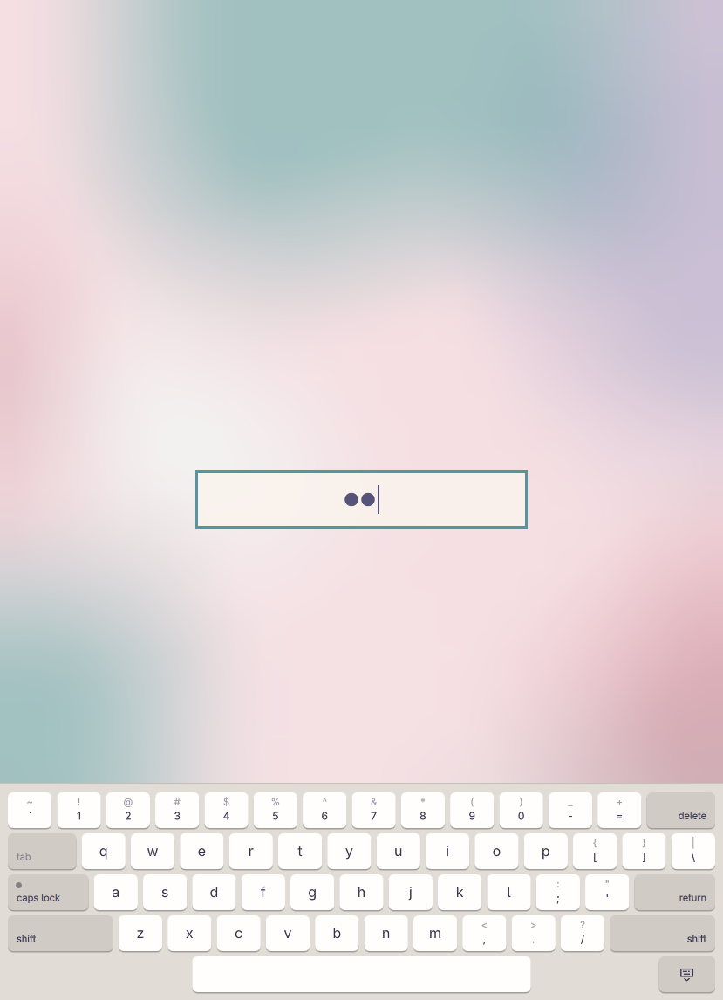

# lock

Omarchy's lock screen with floatkey's keyboard along the bottom, so a tablet
with no keyboard attached can still be unlocked. It is a prototype: it has
been tried in a nested Hyprland, not yet as the real lock screen.



- The keyboard comes up when the lock does and no hardware keyboard is
  attached, and goes down when one connects. It uses floatkey's test for a
  keyboard: a device with Q, A, Z, M and space.
- The key in its bottom right corner hides it; the round keyboard button that
  takes its place brings it back, also with a keyboard attached (one folded
  behind the tablet, say).
- It is floatkey's docked keyboard minus what a password has no use for: shift
  (double-tap to lock), caps lock, a flick down on a key for its upper
  character, delete (hold to repeat), return and the space bar.
- Its layout is picked the way floatkey picks its own: floatkey's `layouts`
  setting, else Hyprland's `input:kb_layout`, starting in the layout floatkey
  was last left in. The globe key appears when there is more than one.
- Keys type straight into the password field, in the order fingers went
  down. Omarchy's lock service and its PAM flow are unchanged.

## Why inside the lock

While a session is locked Hyprland draws the lock's own surfaces and nothing
else, and sends pointer and touch input only to them, so floatkey's overlay
never shows. Hyprland 0.56 has one exception, the `above_lock` layer rule:
`2` draws a layer over the lock and lets it be touched, and keyboard focus stays
on the lock, so virtual keyboard keys reach the password field. This line in
the Hyprland config makes floatkey itself work over the lock (tried in a nested
Hyprland too):

```lua
hl.layer_rule({ match = { namespace = "^floatkey$" }, above_lock = 2 })
```

The catch is that any program can name its layer `floatkey` and then draw
over the lock and take its touches, and floatkey still has to be told to come
up at lock. Keeping the keyboard inside the lock needs no such hole.

## Install

```bash
bin/install
```

This copies Omarchy's lock plugin into `~/.config/omarchy/plugins/omarchy-pad.lock`
with its `LockView.qml` renamed to `UpstreamLockView.qml`, adds this folder's
`LockView.qml` (which wraps it) and `LockKeyboard.qml`, and floatkey's
`KeyIcon.qml` and `layouts.js`, then switches the shell to it as a clone of
`omarchy.lock`. Everything of Omarchy's is copied unchanged, so run it again
after an Omarchy update. To go back to Omarchy's lock screen:

```bash
omarchy plugin remove omarchy-pad.lock
```

## Try it without locking

```bash
tests/try
```

opens a nested Hyprland in a window and prints how to lock it. The password
there is `test`, checked by a throwaway PAM service, so wrong guesses never
count against the real account. It starts with no keyboard attached;
`tests/plug WORK_DIR` connects a fake one and `--unplug` takes it out again.
`tests/try --real-input` uses the devices that are really there.
