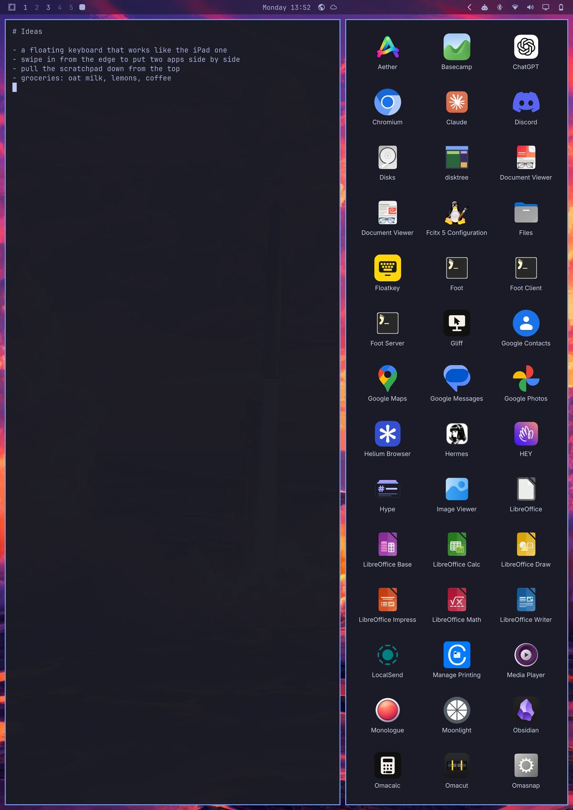
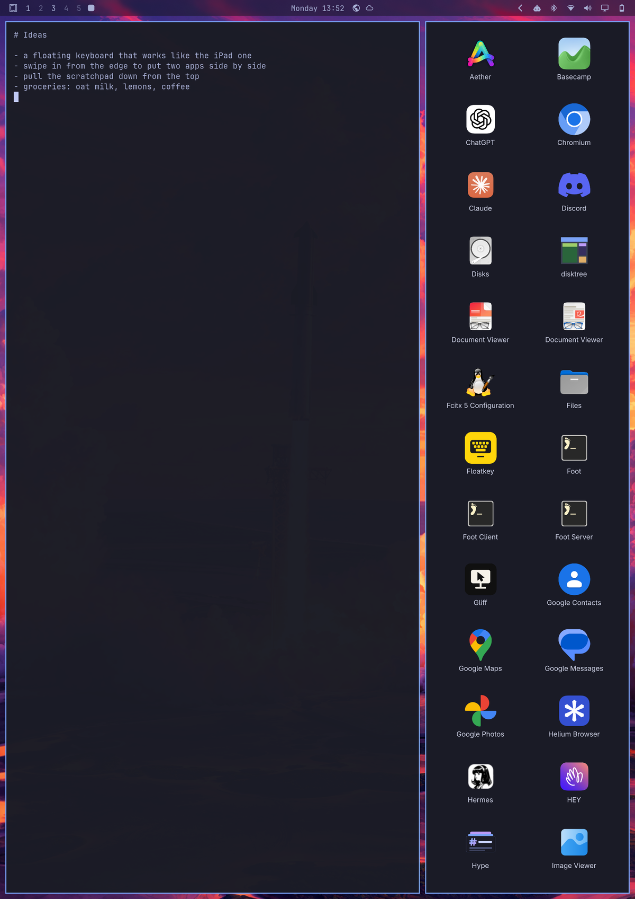
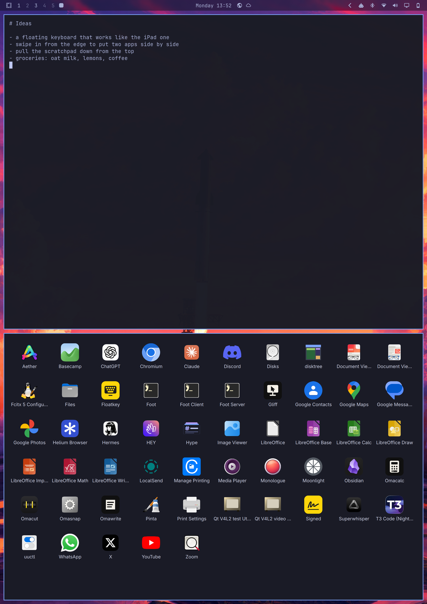
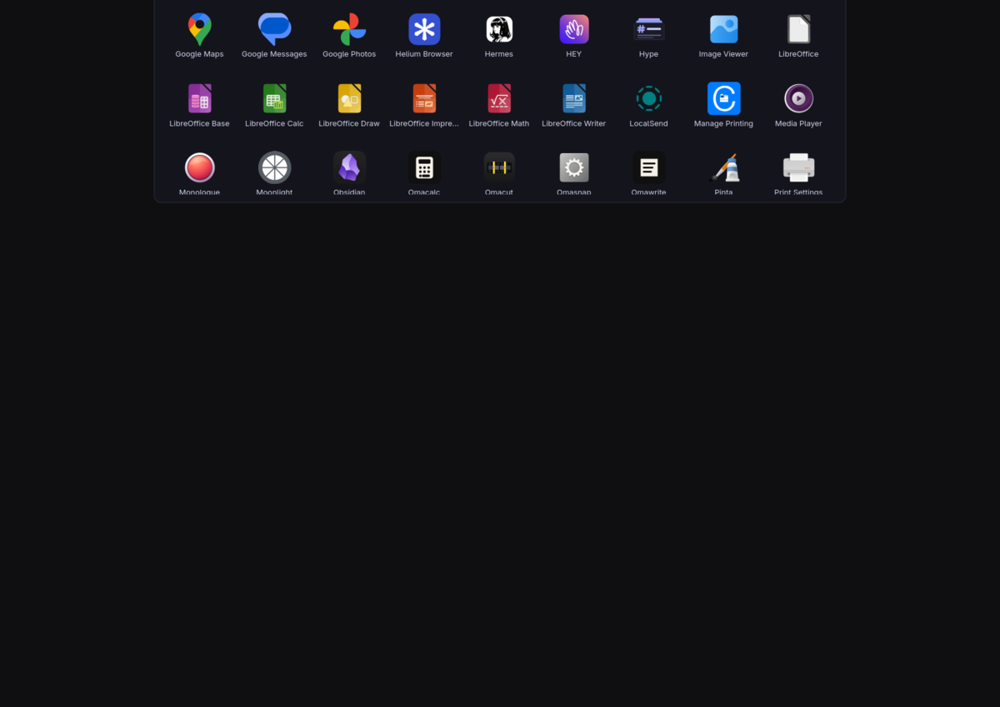

# stage

iPad-style multitasking for Omarchy on a tablet. Drag in from the right edge
and the window under your finger gets smaller: the room it gives up becomes the
launcher, and the app you tap opens there. Drag up from the bottom edge to do
the same the other way. Pull the scratchpad console down from the top.







## Gestures

| Gesture | What it does |
|---|---|
| One finger in from the **right edge** | Shrinks the window beside your finger sideways; the launcher fills the room |
| One finger up from the **bottom edge** | Shrinks the window above your finger upward; the launcher fills the room |
| One finger down from the **top edge** | Pulls Omarchy's scratchpad console down; an empty one offers the launcher |
| Tap or push up on the dimmed screen, or swipe up from the bottom edge | Sends the console back up |
| Two fingers pulled **down** on a window | The window follows them and, let go far enough or flicked, slides off and closes; a short pull puts it back |
| Three fingers sideways | Slides this workspace aside for the next or previous one, following your fingers; a quarter of the way or a flick switches, less goes back. Past the last workspace with windows there is one empty one, to start something new on |
| Three fingers up | Maximizes the focused window |
| Three fingers down | Pulls the window down, as with two |

While you drag, the window keeps its border at your finger, the wallpaper
shows through the gap, and the launcher arrives as a window of its own, with
Hyprland's gaps, border colors and rounding, so it already looks like the
layout it will become. When you let go it lands on a third, a half or two
thirds, whichever is nearest. A short, quick
flick makes halves; a short or slow pull springs back. Tap an app and its window
opens where the launcher was; tap beside the launcher to put things back.

Two and three fingers come straight from the touch screen (stage opens the
devices udev tags as touch screens with libinput, so the user has to be in the
`input` group), because fingers on a window go to that window, not to the
overlay. A pulled window is a picture of it over the wallpaper it leaves; once
Hyprland has closed it, the others move in. A window with something behind it
(floating, or maximized over others) just closes when you let go. The app under
your fingers still sees them, so a page may scroll a little while you pull.
Try it without touching: `stage simulate pull 1150 300 1150 650`, then
`stage simulate release`.

A workspace holds at most four windows (two each way), the console two. Past
that, or splitting a window that already shares its width or height, the
picture only gives a little and springs back, so you can feel there's no more
room. While a docked keyboard owns the bottom edge, only the right and top work.

On an empty workspace the right or bottom edge opens the launcher on the whole screen.



## Commands

```bash
stage                          # run (the tablet session starts it)
stage status                   # console=closed apps=55
stage launch foot right 0.66   # what the launcher does: foot beside the focused window
stage launch firefox console   # ...or in the console
stage console open             # bring the console down; also close
stage simulate drag 1693 600 1200 600   # a finger without a hand, still held;
stage simulate release                  # then release, pick APP or cancel
stage quit
```

## How it works

stage is one transparent layer-shell overlay over the whole screen that only
takes touches in strips along the edges, so a finger landing there reaches
stage instead of the app underneath. The real window never resizes while the
finger moves, which is what keeps it smooth: stage draws over the part it
gives up, with the wallpaper as Omarchy shows it and a new window frame, at
the places dwindle will put the two windows (the split line, minus half a gap
and a border on each side). The console's windows are hidden until it comes
down, so for those stage takes pictures (ext-image-copy-capture) to move.

Letting go on an app tells Hyprland, over its socket, to focus the window that
made room, put the next window beside or under it (dwindle's preselect),
launch the app through `uwsm-app` the way Omarchy does, and once its window is
up, set the split to where your finger left it. The console comes down without
Hyprland sliding it a second time: its `specialWorkspaceIn` animation is
switched off for that one toggle and put back exactly as it was.

## Install

```bash
bin/install
```

On the OnePlus Pad tablet setup (`../tablet`), the tablet session starts
stage.
Keep Hyprland from animating the overlay:

```lua
hl.layer_rule({ match = { namespace = "^stage$" }, no_anim = true, animation = "none" })
```

## Development

```bash
bin/build     # build/stage
bin/test      # unit tests, and the gestures on the real QML, offscreen
QT_LOGGING_RULES="stage.debug=true" build/stage   # what each gesture sees
```
